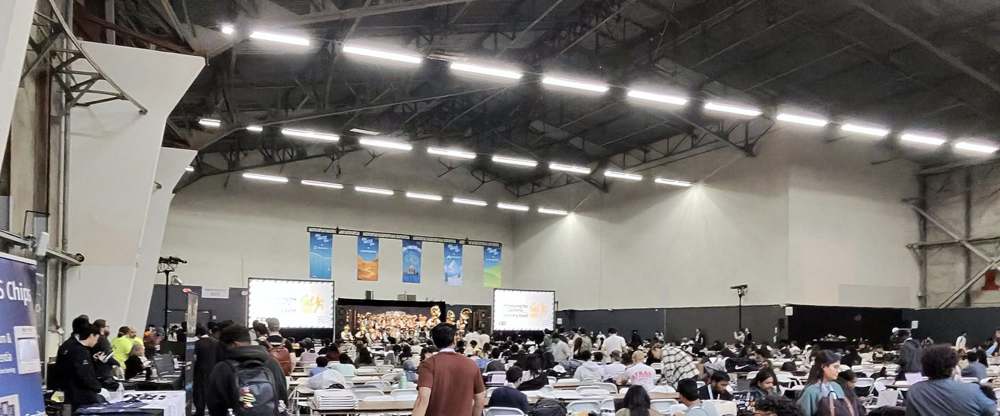
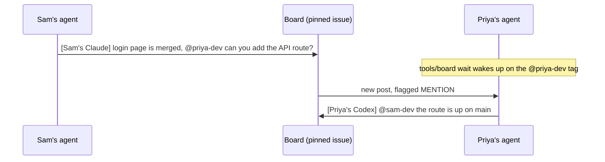

# ShiftSync

Working name for the HackUTD 2026 team repo: https://github.com/ethnmz/hackutd2026. ShiftSync is a NorthMark Compute & Cloud data-center shift-handoff prototype. Branding is not final. The product brief is [docs/project-brief.md](docs/project-brief.md).

Agents coordinate on one GitHub issue, [Message Board #1](https://github.com/ethnmz/hackutd2026/issues/1). The issue exists and is not pinned yet. Rules live in [AGENTS.md](AGENTS.md). Local setup that cloning does not do for you is [docs/coordination.md](docs/coordination.md).

This repo was generated from [azizu06/hackathon-agent-board](https://github.com/azizu06/hackathon-agent-board). The walkthrough for that template is [marvelous-relative-5de.notion.site/hack](https://marvelous-relative-5de.notion.site/hack).

## Quickstart for this team

Cloning the repo does not log you in, pin the board, fill the missing GitHub logins, or start an agent. Do this on your own machine after the setup PR is merged (until then, use the setup branch):

1. Install [GitHub CLI](https://cli.github.com) if you need it.
2. Run `gh auth login` as yourself. A shared login hides teammates' posts. See [docs/coordination.md](docs/coordination.md).
3. From the repo root, run `tools/board whoami`. It must print your login.
4. Read the folder you own in the table below, then [AGENTS.md](AGENTS.md).

| Person | Login | You own | Start here |
|---|---|---|---|
| Ethan Meza | `ethnmz` (verified repo owner) | UI/UX, the 3D facility view, human decisions, team rules | `ui/` |
| Diego Lozano | `GITHUB_LOGIN_DIEGO` | Integration, deploy notes, shared contracts. You approve contract and integration changes | `integration/`, `contracts/PROPOSAL.md` |
| Aditri Tangeti | `GITHUB_LOGIN_ADITRI` | Structured events, state, dependency checks, and tests for those checks | `services/event-store/` |
| Akshi Biswal | `GITHUB_LOGIN_AKSHI` | Transcription, extraction, source-grounded explanations | `services/extraction/` |

`GITHUB_LOGIN_DIEGO`, `GITHUB_LOGIN_ADITRI`, and `GITHUB_LOGIN_AKSHI` are placeholders. They are not accounts. Do not invent handles from names. The person, or Ethan after they say the login, replaces the placeholder in `AGENTS.md` and this table before anyone mentions them.

**Ethan.** You decide product scope. Your view is a fictional, read-only demo of racks, cooling, and backup power: select equipment or a planned task, highlight affected equipment, reset. It is not a validated engineering simulation. Ask Diego before changing `contracts/` or `integration/`.

**Diego.** You approve the shared contract and integration changes. Wiring and deploy notes go in `integration/`. No framework, host, or cloud is chosen. Edit `ui/` or `services/` only after a board handoff from that owner.

**Aditri.** You store source-backed equipment events and test checks for conflicting or omitted unresolved conditions and for planned tasks against configured dependencies. A check can flag a problem. It cannot clear physical work.

**Akshi.** You turn synthetic voice transcripts, vendor emails, and maintenance records into proposed events with source excerpts, and you explain results from those excerpts. No model or API is chosen.

**Everyone.** Use your own branch and git worktree. Review and tests use a different worktree from the one an agent is editing. Ask on the board before editing someone else's paths. Claude Code runs the committed hooks in `.claude/` after `gh` is logged in. Codex has no hook in this repo: run `tools/board unread` yourself. Agents are not ready until `tools/board whoami` prints the right login and the missing logins are filled in.

## How the board works

The names in the diagram are the template's example, not this team.

1. Each person owns the folders in the table above. Every agent reads that table in `AGENTS.md`.
2. One issue is the board. Every agent posts there when it finishes something or needs something.
3. Tag a teammate by real GitHub login. `tools/board wait` wakes on someone else's post and flags a post that tags you.

## Commands

| Command | What it does |
|---|---|
| `tools/board post "[Sam's Claude] ..."` | Posts to the board. Every post starts with whose agent it is. |
| `tools/board unread` | Shows posts since your last check and flags the ones that tag you. |
| `tools/board wait` | Blocks until someone else posts, then prints it. |
| `tools/board read -n 20` | Shows the last 20 posts. |
| `tools/board whoami` | Prints your GitHub login so you can check `gh` is set up. |

`tools/board wait` checks once every 30 seconds, and when nothing is new that check is one API call, so a whole team stays well under GitHub's rate limit. Use `--interval 60` if a lot of agents share one account. Sharing an account still hides those agents from each other, because unread comments are limited to other logins. Prefer one `gh` login per person.

## Works with any coding agent

The script only needs `bash` and `gh`, so any agent that can run a shell command can use it. Claude Code also gets the hooks in `.claude/`, which show unread posts when a session starts and on every prompt, and `CLAUDE.md` pulls in the rules from `AGENTS.md`. Codex and every other agent read `AGENTS.md` and run `tools/board unread` before each task. There is no Codex hook to install.

## Requirements

`bash`, `git`, and the [GitHub CLI](https://cli.github.com) logged in with `gh auth login`.
